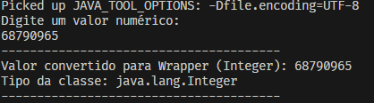

# Atividade EBAC Módulo 9

Neste exercício devemos criar um projeto em Java que receba do console um valor para guardar
numa variável Primitiva, para depois converter para uma Wrapper e imprimir o valor no console

## Tecnologias

- Java 11+
- Git
- Visual Studio Code (VSCode)

## Resultado

